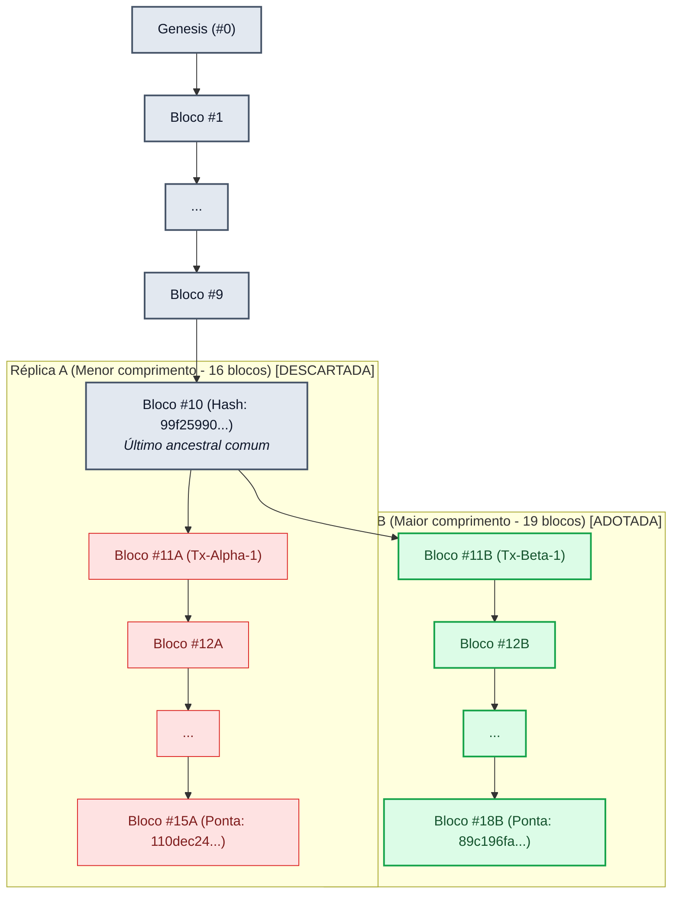

# Relatório Técnico — Atividade Prática 6 (AP6)
## Exploração de Integridade, Replicação e Consenso

**Disciplina:** Sistemas Distribuídos  
**Ambiente de Execução:** Python 3.10+ (Biblioteca Padrão)  
**Arquivo de Execução:** [`ap6_experimento.py`](ap6_experimento.py)  

---

## 1. Introdução e Objetivos

Este relatório documenta os ensaios experimentais da Atividade Prática 6 (AP6). O trabalho investiga o papel prático das funções de hash criptográfico na garantia de integridade de dados e explora por que a validação matemática local não equivale ao consenso em um sistema distribuído.

Por meio de uma implementação didática de encadeamento de blocos, foram avaliadas:
1. A sensibilidade do hash a alterações mínimas de conteúdo (efeito avalanche).
2. A propagação de inconsistências ao adulterar registros históricos.
3. A possibilidade de um agente isolado reconstruir uma cadeia consistente localmente.
4. A coexistência de réplicas concorrentes (*forks*) e a necessidade de uma regra determinística de reconciliação.

---

## 2. Metodologia e Estrutura dos Blocos

O modelo foi construído no arquivo `ap6_experimento.py` utilizando apenas recursos nativos do Python (`dataclasses`, `hashlib`, `json`). A estrutura de cada bloco contém:

```python
@dataclass
class Block:
    index: int
    timestamp: str
    data: dict
    previous_hash: str
    nonce: int = 0
    hash: str = ""
```

* **Serialização determinística:** A conversão de dados em bytes emprega `json.dumps(..., sort_keys=True, separators=(',', ':'))`, garantindo que chaves e espaçamentos não introduzam divergências espúrias no cálculo do SHA-256.
* **Validação de cadeia (`is_valid`):**
  * O hash de cada bloco deve corresponder exatamente ao cálculo SHA-256 dos seus campos.
  * O campo `previous_hash` de cada bloco $i$ ($i > 0$) deve ser idêntico ao campo `hash` do bloco $i-1$.

---

## 3. Tabela de Experimentos e Resultados

Foram gerados **20 blocos** (além do bloco Gênesis #0), totalizando 21 blocos na cadeia canônica. A tabela a seguir sumariza as ações e os comportamentos observados:

| Experimento | Alvo | Ação Realizada | Validação Local | Diagnóstico do Sistema |
| :--- | :--- | :--- | :---: | :--- |
| **1. Cadeia Canônica** | Blocos #0 a #20 | Geração sequencial de 20 blocos com transações sintéticas | **True** | Cadeia íntegra. Todos os ponteiros conferem. |
| **2. Efeito Avalanche** | Bloco #5 | Alteração de 1 caractere no campo `origem` (`Conta_A0` $\rightarrow$ `Contx_A0`) | N/A | **120 de 256 bits alterados (46.9%)**. Hash modificado radicalmente. |
| **3. Adulteração sem Recálculo** | Bloco #10 | Modificação do valor da transação de `105.0` para `999999.99` | **False** | Violação detectada no Bloco #10 (`hash armazenado != recalculado`). |
| **3b. Atualização Parcial** | Bloco #10 | Atualizado o hash do Bloco #10, mas sem propagar aos seguintes | **False** | Violação detectada no Bloco #11 (`previous_hash != hash do Bloco #10`). |
| **4. Falsificação Local** | Blocos #10 a #20 | Recálculo em cadeia de ponteiros e hashes de #10 até #20 | **True** | **Cadeia aceita localmente**. O nó refez todos os ponteiros com sucesso. |
| **5. Réplicas Divergentes** | Réplica A vs B | Bifurcação no Bloco #10: Ramo A (+5 blocos) e Ramo B (+8 blocos) | **True em ambas** | Ambas as cadeias são válidas internamente, mas incompatíveis entre si. |
| **5b. Reconciliação** | Nó A e Nó B | Aplicação da regra da cadeia mais longa (*Longest Chain Rule*) | **True** | Nó A reorganiza seu estado, adotando a Réplica B (19 blocos vs 16 blocos). |

---

## 4. Comparativo de Hashes: Cadeia Original vs Falsificada

A tabela abaixo compara os hashes de referência da cadeia íntegra com os hashes obtidos após a adulteração do Bloco #10 e recálculo subsequente:

| Bloco | Status | Hash Original (SHA-256) | Hash Após Recálculo Local |
| :---: | :---: | :--- | :--- |
| **#00** | Mantido | `3ba616adf54e...ff942d2b` | `3ba616adf54e...ff942d2b` |
| **#01** | Mantido | `fc4602f417f1...8a92667f` | `fc4602f417f1...8a92667f` |
| **#02** | Mantido | `19a934e1b782...d54df55a` | `19a934e1b782...d54df55a` |
| **#03** | Mantido | `c6b954605013...9d31edcc` | `c6b954605013...9d31edcc` |
| **#04** | Mantido | `ff93614c5267...45efb92` | `ff93614c5267...45efb92` |
| **#05** | Mantido | `799cded3beca...d34c98f0` | `799cded3beca...d34c98f0` |
| **#06** | Mantido | `a94fa447233d...dad25467` | `a94fa447233d...dad25467` |
| **#07** | Mantido | `34a295aaab77...4f599b3` | `34a295aaab77...4f599b3` |
| **#08** | Mantido | `82bda73dd647...7bbae6e` | `82bda73dd647...7bbae6e` |
| **#09** | Mantido | `6d410cee0a5f...266349cc` | `6d410cee0a5f...266349cc` |
| **#10** | **Adulterado** | `99f25990acd6...3b58fb0a` | `8686bf5857c6...e52d577f` |
| **#11** | Recalculado | `b99a97a6eb39...212dbdfb` | `b31c3e390719...87b346c8` |
| **#12** | Recalculado | `28b8763abf64...814bc046` | `9592e7815c7e...41bb1f4a` |
| **#13** | Recalculado | `54e01def8539...f5cf325c` | `edf0445595fc...4f3c6d94` |
| **#14** | Recalculado | `3483ae46845e...a1971184f` | `0008eeef7203...dc004619` |
| **#15** | Recalculado | `14cc5af41693...fdce1db6` | `799038a08431...a290c37b` |
| **#16** | Recalculado | `ab73e13f2755...bcc69fc6` | `45e6a3a9de1b...9e2a72ca` |
| **#17** | Recalculado | `74d86a96b9e1...76100827` | `9fb6fc83f63b...223c4665` |
| **#18** | Recalculado | `e8430dbc43b0...e87d8e11` | `ef6da446f2f2...0917927e` |
| **#19** | Recalculado | `6c05b165b273...55c13244` | `7a1267e29f84...3c6b6ce5` |
| **#20** | Recalculado | `72f243145f6a...d2fb3390` | `ffe3684fd2d8...8f4201a` |

---

## 5. Diagrama das Réplicas Divergentes (*Fork*)

O diagrama a seguir representa o experimento de bifurcação a partir do Bloco #10 e a posterior resolução por meio da regra da maior cadeia:



---

## 6. Análise Técnica: "Hash não é Consenso"

### Questão 1: Por que recalcular todos os hashes pode “consertar” localmente uma cadeia adulterada?
A verificação local de uma cadeia checa apenas se as propriedades matemáticas internas foram satisfeitas: se $H_i = \text{SHA256}(B_i)$ e se o ponteiro `previous_hash` do bloco seguinte corresponde a esse valor.

Em uma máquina isolada e sem restrições de trabalho assimétrico (como dificuldade de mineração), o custo computacional de calcular hashes SHA-256 é insignificante. Um nó que controle seu próprio armazenamento consegue alterar qualquer dado no passado e atualizar sequencialmente todos os ponteiros posteriores em frações de milissegundo. Sob a ótica estrita do validador local, a cadeia resultante é estruturalmente perfeita. O hash assegura que o arquivo não foi corrompido acidentalmente em disco, mas não comprova que aquele histórico é a versão aceita pelos demais participantes.

### Questão 2: O que impede um participante de distribuir sua versão adulterada em uma rede real?
Em uma rede distribuída com múltiplos nós autônomos, um participante que recalcula sua cadeia localmente não consegue impô-la aos pares pelos seguintes motivos:
1. **Mecanismo de Prova de Custo (Proof of Work / Proof of Stake):** Em redes reais, gerar blocos requer trabalho computacional cumulativo ou alocação substancial de capital. Recalcular múltiplos blocos passados exige refazer todo o trabalho da cadeia honesta, que continuou avançando em paralelo.
2. **Regra de Escolha de Garfo (*Fork Choice Rule*):** Nós vizinhos comparam o trabalho acumulado (*chainwork*) de cadeias concorrentes. Versões com menor trabalho comprovado são descartadas automaticamente.
3. **Validação de Regras de Transição de Estado:** Mesmo que um nó conseguisse poder computacional suficiente, cada nó da rede valida individualmente as assinaturas digitais e as regras de saldo de cada transação. Transações forjadas ou sem assinatura válida são rejeitadas de imediato, independentemente do tamanho da cadeia ou da consistência dos hashes.

### Questão 3: Que informação adicional um protocolo de consenso precisa considerar?
Além da validade formal de cada bloco individual, um protocolo de consenso distribuído precisa avaliar:
* **Métrica de Esforço Acumulado:** Trabalho computacional total consolidado (*cumulative difficulty*) ou peso de votos/participação econômica dos validadores.
* **Ordem Causal de Transações:** Mecanismos para detectar e desempatar transações concorrentes que tentem movimentar os mesmos recursos (prevenção de gasto duplo).
* **Finalidade e Regras de Reorganização:** Limites de profundidade a partir dos quais blocos antigos não podem mais ser revertidos (*finality checkpoints*).
* **Identidade e Autoridade de Proposição:** Critérios determinísticos de eleição de líderes ou comitês para propor blocos em cada época ou altura de bloco.

### Questão 4: Qual relação existe entre fork e concorrência de eventos?
Em sistemas distribuídos, a inexistência de um relógio global perfeitamente sincronizado e a presença de latências de rede variáveis fazem com que componentes distintos observem eventos em momentos diferentes.

Segundo o modelo causal de Leslie Lamport, dois eventos $A$ e $B$ são considerados concorrentes quando não existe relação causal direta entre eles ($A \not\rightarrow B$ e $B \not\rightarrow A$). Um *fork* reflete esse fenômeno: dois nós distintos geram blocos válidos em instantes próximos, ambos referenciando o mesmo bloco anterior ($B_{10}$). Para nós mais próximos do primeiro minerador, o bloco $11A$ chegou primeiro; para nós mais próximos do segundo, o bloco $11B$ chegou primeiro. Como ambos os blocos são legítimos e concorrentes, a rede temporariamente mantém dois ramos válidos até que o protocolo de consenso selecione um ramo canônico nos blocos seguintes.

---

## 7. Limitações da Regra de Reconciliação Adotada

A simulação utilizou a regra da **maior cadeia** (*Longest Chain Rule*). Em um cenário didático sem custo de geração de blocos (`difficulty = 0`), essa regra apresenta limitações severas:
* **Vulnerabilidade a criação trivial de blocos:** Sem Proof of Work, qualquer nó pode forjar uma cadeia com milhares de blocos vazios e forçar os demais nós a reorganizarem seus estados.
* **Reorganizações destrutivas (*Deep Reorgs*):** Sem critérios de finalidade, transações confirmadas poderiam ser revertidas a qualquer momento caso uma cadeia maior surgisse.
* **Ausência de validação de assinaturas:** A reconciliação didática analisa apenas o comprimento da lista de blocos, sem validar se as transações contidas possuem autenticidade criptográfica por chave assimétrica.

---

## 8. Conclusão

Os experimentos realizados ilustram que o hash criptográfico é um componente indispensável para conferir **integridade e encadeamento verificável**, mas não constitui **consenso**. Consenso distribuído exige coordenação, incentivos contra fraudes e regras determinísticas de resolução de conflitos temporais e concorrentes entre participantes que não confiam uns nos outros.
