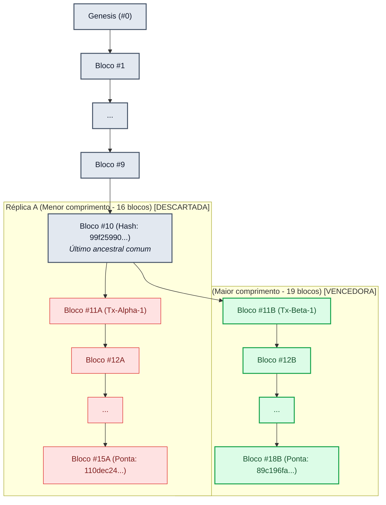

# Relatório Técnico — Atividade Prática 6 (AP6)
# Exploração de Integridade, Replicação e Consenso

**Disciplina:** Sistemas Distribuídos  
**Data:** 14 de Outubro de 2026  
**Ambiente de Execução:** Python 3.10+ (Biblioteca Padrão: `hashlib`, `json`, `dataclasses`)  
**Código Fonte:** [`ap6_experimento.py`](atividade_pratica6/ap6_experimento.py)

---

## 1. Introdução e Objetivos

Este relatório documenta os experimentos práticos da **AP6**, cujo objetivo é investigar as fronteiras entre **integridade criptográfica local** e **consenso distribuído global**. 

A premissa central demonstrada é que mecanismos de hashing (como SHA-256) e encadeamento linear de ponteiros criptográficos (*hash pointers*) são fundamentais para assegurar a **imutabilidade e detecção de violações locais**, mas são **incapazes de produzir consenso distribuído por si sós**. Em uma rede descentralizada, validar a consistência matemática de uma cadeia não elimina o problema de históricos concorrentes (*forks*) nem impede ataques em que um participante reescreve localmente a história.

---

## 2. Metodologia e Estrutura de Dados

O experimento foi implementado de forma autocontida no script [`ap6_experimento.py`](atividade_pratica6/ap6_experimento.py). A estrutura de cada bloco obedece ao padrão didático:

```python
@dataclass
class Block:
    index: int
    timestamp: str
    data: dict
    previous_hash: str
    nonce: int = 0
    hash: str = ""
```

* **Serialização determinística:** Utilizou-se `json.dumps(..., sort_keys=True, separators=(',', ':'))` garantindo que a mesma carga útil gere invariavelmente a mesma sequência binária antes do hashing SHA-256.
* **Critério de Validação Local (`is_valid`):**
  1. $H_i = \text{SHA256}(B_i)$ para todo $i$.
  2. $B_i.\text{previous\_hash} == B_{i-1}.\text{hash}$ para todo $i > 0$.

---

## 3. Tabela de Experimentos e Resultados

Abaixo são consolidados os cenários experimentais executados com base na cadeia canônica de **20 blocos gerados**:

| Experimento | Alvo | Modificação Realizada | Hash Resultante (Prefixo) | Validação Local (`is_valid()`) | Diagnóstico do Sistema |
| :--- | :--- | :--- | :--- | :---: | :--- |
| **1. Cadeia Íntegra** | Blocos #0 a #20 | 20 blocos gerados normalmente | Ponta (#20): `72f243145f6a...` | **True** | Cadeia 100% íntegra e consistente. |
| **2. Efeito Avalanche** | Bloco #5 | Alteração de 1 caractere (`Conta_A0` $\rightarrow$ `Contx_A0`) | `8c3eb5abeef2...` (vs `799cded3beca...`) | N/A (bloco isolado) | **46.9% dos bits alterados** (120 de 256 bits; 58 de 64 caracteres hex). |
| **3. Adulteração sem Recálculo** | Bloco #10 | Valor alterado de `105.0` para `999999.99` (sem atualizar hashes) | `8686bf5857c6...` (recalculado) vs `99f25990acd6...` (gravado) | **False** | Violação detectada no próprio Bloco #10 (`hash armazenado != recalculado`). |
| **3b. Adulteração com Hash de #10** | Bloco #10 | Atualizado apenas o hash de #10, sem propagar a #11..#20 | `8686bf5857c6...` | **False** | Violação detectada no Bloco #11 (`previous_hash != hash do Bloco #10`). |
| **4. Falsificação Local (Recálculo)** | Blocos #10 a #20 | Recálculo sequencial de ponteiros e hashes de #10 a #20 | Ponta (#20): `ffe3684fd2d8...` | **True** | **Cadeia adulterada é aceita como válida localmente**, pois todos os ponteiros foram matematicamente reconstruídos. |
| **5. Simulação de Réplicas (Fork)** | Réplica A vs Réplica B | Bifurcação no Bloco #10: Réplica A (+5 blocos); Réplica B (+8 blocos) | Rép A: `110dec243c6a...` (Tam: 16)<br>Rép B: `89c196fa14f9...` (Tam: 19) | **True em ambas** | Ambas são internamente válidas, mas contêm transações incompatíveis. |
| **5b. Reconciliação Distribuída** | Nó A recebe Réplica B | Aplicação da regra *Longest Chain Rule* | Ponta adotada: `89c196fa14f9...` (Tam: 19) | **True** | Nó A reorganiza seu histórico, descartando o Ramo A e adotando o Ramo B. |

---

## 4. Evidências dos Hashes: Cadeia Original vs Falsificada

A tabela a seguir apresenta os hashes reais emitidos pela execução do script, comprovando o impacto da propagação do recálculo a partir do Bloco #10:

```text
Bloco  | Status       | Hash Original (SHA-256)                                          | Hash Falsificado Localmente (SHA-256)
-----------------------------------------------------------------------------------------------------------------------------------------------------------
#00    | INALTERADO   | 3ba616adf54e814a0a67a730a92636238588333791621017a51e2335ff942d2b | 3ba616adf54e814a0a67a730a92636238588333791621017a51e2335ff942d2b
#01    | INALTERADO   | fc4602f417f1f1747a33dd26da62e9d9e2a88eae12bb67af15f363b68a92667f | fc4602f417f1f1747a33dd26da62e9d9e2a88eae12bb67af15f363b68a92667f
#02    | INALTERADO   | 19a934e1b782a2713caf4310371404980d031d8e56b9f721c43b1a38d54df55a | 19a934e1b782a2713caf4310371404980d031d8e56b9f721c43b1a38d54df55a
#03    | INALTERADO   | c6b954605013415436ec04d1a13bc4338b0a604140c8a95e5391ea1d9d31edcc | c6b954605013415436ec04d1a13bc4338b0a604140c8a95e5391ea1d9d31edcc
#04    | INALTERADO   | ff93614c52674bf589c2c94a0e5698fe4510882dcec2416c62fc26f7f45efb92 | ff93614c52674bf589c2c94a0e5698fe4510882dcec2416c62fc26f7f45efb92
#05    | INALTERADO   | 799cded3beca529e89c9e0f26e62b967fdcd84fe8cc91468124dad60d34c98f0 | 799cded3beca529e89c9e0f26e62b967fdcd84fe8cc91468124dad60d34c98f0
#06    | INALTERADO   | a94fa447233d691f7400d1462ba0e766f29b54461ff6434b47a06b1fdad25467 | a94fa447233d691f7400d1462ba0e766f29b54461ff6434b47a06b1fdad25467
#07    | INALTERADO   | 34a295aaab775b4d29f36dba22347db38ff8362b766418861f6cd53304f599b3 | 34a295aaab775b4d29f36dba22347db38ff8362b766418861f6cd53304f599b3
#08    | INALTERADO   | 82bda73dd6472a1f77a10c033a105fde982a8370c6547fb9d1781383f7bbae6e | 82bda73dd6472a1f77a10c033a105fde982a8370c6547fb9d1781383f7bbae6e
#09    | INALTERADO   | 6d410cee0a5f14b30f460098647b41b9caee97716d87681a22443729266349cc | 6d410cee0a5f14b30f460098647b41b9caee97716d87681a22443729266349cc
#10    | REESCRITO    | 99f25990acd6ef263974018bb4e07d56da4b69ecc25d5a24fdd8e44f3b58fb0a | 8686bf5857c61105a983e48d5c74967abaa104d69e913e445d1bfab0e52d577f
#11    | REESCRITO    | b99a97a6eb39c71e3091028b3d4c11545f320c6a6c0ee88e68430ba9212dbdfb | b31c3e390719a86e9f59af78f5bbaeb31814ac8dccb876e7535e942687b346c8
#12    | REESCRITO    | 28b8763abf64755505ef8ae43108543332a81f5a36fa78d0d9417989814bc046 | 9592e7815c7ef4e3dfd50fecea62749a079019452a008fce4f5c3c9741bb1f4a
#13    | REESCRITO    | 54e01def85395f6b24e22d538a2447558e0fc53afccbb32a442dcdfff5cf325c | edf0445595fc2f23930e00556e20632a1012c0d4091b37f4b2e16b484f3c6d94
#14    | REESCRITO    | 3483ae46845e091d00c089636c81e9cba4f31810d082fbea43d43b5a1971184f | 0008eeef72039c1b926f742da162a46e6a26f4e4c7ab2576ea0d6cd0dc004619
#15    | REESCRITO    | 14cc5af41693354d84d7879142808f96db81d001a08ae7cda02b38f4fdce1db6 | 799038a0843107bb799dd85bb18121cebac33eca38c19ba85ea1d085a290c37b
#16    | REESCRITO    | ab73e13f2755eb3d173c72776b1a0930858f7bf7712b2c25c56f3a9ebcc69fc6 | 45e6a3a9de1b5589ebcd59e4dccfdcb8a27d51d4369491f7747b35369e2a72ca
#17    | REESCRITO    | 74d86a96b9e10eae65eb39b8fd6e1e9268a6d8cbef7bcd5059f4cf7c76100827 | 9fb6fc83f63bb02eef2a244c47e26af5f7bb74ac72487bc7bca192cf223c4665
#18    | REESCRITO    | e8430dbc43b0a7281a72f49687ce9bf715812e44d0c642214abbbd11e87d8e11 | ef6da446f2f2e4daf49b9933dd32560a6e4a11f682fe9b8cbb9e19480917927e
#19    | REESCRITO    | 6c05b165b273890ca11935932150ca9e269ddb4c8a5605dd0785455c55c13244 | 7a1267e29f84619ba1c1f186291d24238761deee2248feb82e3bedbc3c6b6ce5
#20    | REESCRITO    | 72f243145f6ae217ad7c0334c687c33b2f88ef5a963fdce4f741abedd2fb3390 | ffe3684fd2d82dcd6913b59699ed66ee5bf0342a02db97bd52778c95e8f4201a
```

---

## 5. Diagrama das Réplicas Divergentes (*Fork*)

O diagrama abaixo ilustra o comportamento observado no Experimento 5, onde a partir de uma base comum (Gênesis até o Bloco #10), duas réplicas autônomas evoluem de forma concorrente:



---

## 6. Análise Técnica: "Hash Não é Consenso"

A criptografia de hash é comumente confundida com consenso distribuído por leigos. Esta seção responde às 4 questões fundamentais da atividade para desmistificar essa relação.

### Questão 1: Por que recalcular todos os hashes pode “consertar” localmente uma cadeia adulterada?
**Resposta:**  
Uma função hash criptográfica como o SHA-256 é um algoritmo matemático determinístico e de via única. A propriedade de integridade da blockchain baseia-se na verificação de que o ponteiro `previous_hash` do bloco $i+1$ coincide com o hash resultante dos dados do bloco $i$.

Quando um atacante adultera o conteúdo do Bloco #10 e recalcula sequencialmente os blocos #11 a #20 em sua própria máquina, ele está simplesmente satisfazendo as equações matemáticas locais exigidas pela função `is_valid()`. Como o cálculo de um SHA-256 consome frações ínfimas de microssegundo em hardware moderno (ausente um mecanismo de trabalho assimétrico como Proof of Work), o nó local consegue reescrever toda a história subsequente em menos de 1 milissegundo. Para o validador que analisa apenas a estrutura interna daquela lista, **a cadeia parece 100% íntegra e matematicamente válida**. A matemática do hash certifica consistência interna, mas não atesta veracidade histórica ou acordo distribuído.

### Questão 2: O que impede um participante de distribuir sua versão adulterada em uma rede real?
**Resposta:**  
Em uma rede distribuída real (como Bitcoin ou Ethereum), um nó que recalcula localmente sua cadeia não consegue impor sua versão aos demais participantes devido a três defesas estruturais:
1. **Mecanismo de Prova de Custo (ex.: Proof of Work / Proof of Stake):** A rede exige que cada bloco satisfaça um critério de extrema dificuldade probabilística (alvo de zeros). Recalcular 10 blocos honestos exige despender uma quantidade astronômica de energia e poder computacional. Um atacante precisaria de mais de 51% do poder computacional global para superar a cadeia honesta que continuou avançando cumulativamente.
2. **Regra de Escolha de Garfo (*Fork Choice Rule*):** Os nós da rede utilizam regras estritas (como a cadeia com maior trabalho acumulado — *heaviest chain*). Ao receber duas cadeias matematicamente válidas, os nós descartam a versão com menor trabalho acumulado.
3. **Validação Descentralizada de Regras de Negócio:** Mesmo que o atacante tenha poder computacional, os nós vizinhos validam as assinaturas digitais e a legalidade das transações contidas no bloco. Uma adulteração que forja fundos sem assinatura válida de chave privada é sumariamente rejeitada por cada nó independente, independentemente do hash ou Proof of Work.

### Questão 3: Que informação adicional um protocolo de consenso precisa considerar?
**Resposta:**  
Um protocolo de consenso distribuído precisa considerar um conjunto de metadados e restrições que vão muito além do hash estático de cada bloco:
* **Trabalho Acumulado / Peso da Cadeia (*Chainwork* ou *Weight*):** Métrica acumulada do esforço criptográfico ou da quantidade de moedas/validadores (em PoS) que endossaram aquele histórico.
* **Ordem Temporal e Causal (Prevenção de Gasto Duplo):** Critérios para desempate entre transações concorrentes que tentam gastar os mesmos fundos (*double spending*).
* **Finalidade e Pontos de Verificação (*Finality & Checkpoints*):** Critérios econômicos ou algorítmicos que impedem reorganizações profundas após determinado número de confirmações ou épocas (*epochs*).
* **Autoridade e Assinatura Digital dos Proponentes:** Identificação criptográfica do nó ou comitê eleito para propor o bloco na respectiva rodada/altura.

### Questão 4: Qual relação existe entre fork e concorrência de eventos?
**Resposta:**  
Em sistemas distribuídos, a ausência de um relógio físico global perfeito (decorrente da relatividade física e do desvio/jitter de rede) faz com que a ordenação de eventos dependa do conceito de **causalidade e precedência lógica** (modelo de *happened-before* de Leslie Lamport).

Um *fork* (bifurcação) é a manifestação direta da **concorrência de eventos** na rede: dois mineradores ou validadores independentes e geograficamente distantes criam blocos válidos quase ao mesmo tempo, ambos referenciando o mesmo bloco anterior ($B_{10}$). Devido à latência finita de propagação da rede, metade da rede recebe primeiro o Bloco $11A$ e a outra metade recebe o Bloco $11B$. Ambos os eventos são concorrentes ($11A \not\rightarrow 11B$ e $11B \not\rightarrow 11A$). O *fork* persiste até que novos eventos quebrem a simetria (ex.: um bloco subsequente seja minerado sobre um dos ramos), permitindo que o protocolo de consenso selecione determinística e retroativamente o ramo canônico.

---

## 7. Discussão da Regra de Reconciliação e Limitações

A regra implementada na Etapa 5 adota a **Cadeia Válida Mais Longa** (*Longest Chain Rule*). 

### Limitações do Modelo Didático:
1. **Vulnerabilidade a Ataques Sybil e Spoofing Local:** Como o custo de mineração no modelo didático é nulo (`difficulty=0`), qualquer nó malicioso pode gerar instantaneamente 1.000 blocos vazios e forçar a rede a aceitar sua versão por ser "mais longa".
2. **Reorganizações Catastróficas (*Deep Reorgs*):** Sem regras de finalidade ou penalidades (*slashing*), transações consolidadas há muito tempo podem ser anuladas se surgir uma cadeia alternativa artificialmente mais longa.
3. **Consumo de Banda e Armazenamento:** A reconciliação ingênua exige baixar e validar toda a cadeia concorrente na memória, sem paginação de cabeçalhos (*headers-first synchronization*).

---

## 8. Conclusão

Os experimentos da AP6 demonstraram de forma inequívoca que:
1. O **hash SHA-256** oferece **integridade estrutural** e detecção imediata de violações pontuais graças ao efeito avalanche.
2. O **encadeamento de hashes** detecta alterações não coordenadas em registros históricos.
3. **A validação local é impotente contra um agente com permissão de reescrita local**, pois recalcular ponteiros criptográficos é computacionalmente trivial.
4. O **consenso distribuído** requer incentivos econômicos, prova de trabalho/participação e regras de garfo coordenadas globalmente para impedir a falsificação de histórico.
