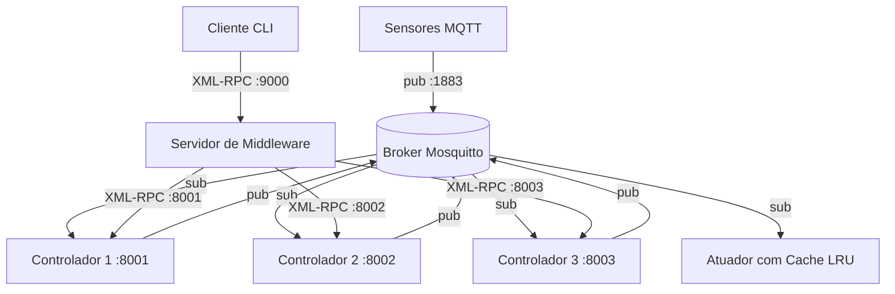

# Trabalho Prático 1 — Sistemas Distribuídos
## Controle Automatizado de Estufa Agrícola com MQTT e XML-RPC

**Relatório Técnico:** [`relatorio/relatorio.md`](relatorio/relatorio.md)

Implementação de um sistema distribuído para monitoramento e acionamento automatizado de uma estufa agrícola. A arquitetura integra mensageria assíncrona publicar/assinar (MQTT) para telemetria e atuação, invocação remota de procedimentos (XML-RPC) para coordenação entre processos, replicação ativa de controladores com votação majoritária ($N = 2f + 1 = 3$) e deduplicação de comandos no atuador via cache LRU.

---

## Arquitetura do Sistema



### Componentes e Estrutura

| Componente | Arquivo | Papel Arquitetural |
|---|---|---|
| **Configuração** | `estufa/config.py` | Tópicos MQTT, portas XML-RPC, limiares de controle e parâmetros de quórum |
| **Sensor** | `estufa/sensor.py` | Publica leituras simuladas de temperatura e umidade do solo via MQTT (QoS 1) |
| **Controlador (×3)** | `estufa/controlador.py` | Consome sensores, avalia regras de controle, persiste estado em JSON e expõe servidor XML-RPC (`:8001`–`:8003`) |
| **Motor de Votação** | `estufa/middleware.py` | Invoca as réplicas em paralelo e apura quórum mínimo (2 de 3) |
| **Servidor de Middleware** | `estufa/middleware_server.py` | Processo XML-RPC na porta `9000`; ponto único de acesso para o cliente e para sincronização de réplicas |
| **Atuador** | `estufa/atuador.py` | Subscreve aos tópicos de acionamento e filtra comandos redundantes das réplicas com cache LRU |
| **Cliente** | `estufa/cliente.py` | Interface CLI para consulta de estado, acionamento manual e verificação de saúde do cluster |

---

## Mecanismos de Sistemas Distribuídos

1. **Transparência de Acesso e Replicação:** O cliente comunica-se exclusivamente com o servidor de Middleware (`:9000`), sem conhecer a localização individual das réplicas (`:8001`–`:8003`).
2. **Transferência de Estado na Inicialização (*State Transfer*):** Ao iniciar ou recuperar-se de falha, cada controlador sincroniza seu estado consultando o quórum vigente no Middleware antes de consumir mensagens MQTT.
3. **Deduplicação de Comandos:**
   - **Acionamento autônomo:** Cada réplica calcula `comando_id = MD5(acao + sensor_timestamp)`. Como todas processam o mesmo evento publicado pelo sensor, geram o mesmo identificador.
   - **Acionamento manual:** O Middleware gera um `UUID4` por requisição e o repassa às 3 réplicas.
   - O atuador mantém um cache LRU (`OrderedDict`) dos últimos `comando_id` processados, executando cada transição física uma única vez.

---

## Pré-requisitos e Instalação

- **Python 3.10+**
- **Broker MQTT** na porta `1883` (via Docker Compose com Eclipse Mosquitto ou serviço local equivalente)

```bash
python3 -m venv .venv
source .venv/bin/activate   # No Windows (PowerShell): .\.venv\Scripts\Activate.ps1
pip install -r requirements.txt
```

---

## Execução

A ordem de inicialização respeita a dependência de sincronização de estado: **Broker MQTT → Servidor de Middleware → Controladores → Atuador → Sensor → Cliente**.

### Inicialização por Script

- **Linux / macOS:**
  ```bash
  bash scripts/start_all.sh
  python3 -m estufa.cliente
  ```
- **Windows (PowerShell):**
  ```powershell
  .\scripts\start_all.ps1
  python -m estufa.cliente
  ```

### Inicialização Manual por Processo

Com o ambiente virtual ativo em cada terminal:

```bash
# 1. Broker MQTT
docker compose up -d

# 2. Servidor de Middleware (porta 9000)
python -m estufa.middleware_server

# 3. Réplicas de Controlador (portas 8001, 8002 e 8003)
python -m estufa.controlador --id ctrl_1 --port 8001 --data data_ctrl_1.json
python -m estufa.controlador --id ctrl_2 --port 8002 --data data_ctrl_2.json
python -m estufa.controlador --id ctrl_3 --port 8003 --data data_ctrl_3.json

# 4. Atuador
python -m estufa.atuador

# 5. Sensor (perfis disponíveis: normal, seco, quente, frio)
python -m estufa.sensor --modo normal

# 6. Cliente interativo (ou --auto para consulta contínua)
python -m estufa.cliente
```

### Simulação de Falha Bizantina

Para iniciar uma das réplicas simulando comportamento bizantino (retorno de leituras adulteradas e estados invertidos):

```bash
python -m estufa.controlador --id ctrl_2 --port 8002 --data data_ctrl_2.json --byzantino
```

---

## Limiares de Controle e Tolerância a Falhas

| Variável | Condição | Atuador | Ação |
|---|---|---|---|
| Temperatura | `> 35.0 °C` | Exaustor | Ligar |
| Temperatura | `< 15.0 °C` | Exaustor | Desligar |
| Umidade do Solo | `< 30.0 %` | Bomba de Irrigação | Ligar |
| Umidade do Solo | `> 70.0 %` | Bomba de Irrigação | Desligar |

| Cenário | Comportamento do Sistema |
|---|---|
| 1 controlador inativo (*crash*) | Quórum 2/3 mantido; operação normal sem interrupção |
| 1 controlador bizantino | Resposta divergente descartada na votação majoritária (2 votos honestos contra 1) |
| 2 ou mais controladores inativos | `ErroQuorum` reportado ao cliente por ausência de maioria |
| Reinicialização de réplica | Sincronização automática do estado atual via Middleware no boot |

---

## Testes Automatizados

A suíte utiliza `pytest` com *mocks* para isolamento das chamadas de rede e não exige broker ou processos externos em execução:

```bash
pytest tests/ -v
```
