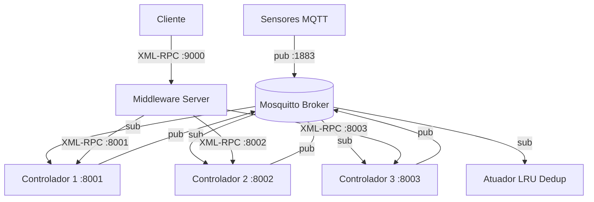

# Trabalho Prático 1 - Sistemas Distribuídos
## Estufa Agrícola Automatizada — Sistema Distribuído com MQTT e XML-RPC

> **Relatório Técnico Completo:** [`relatorio/relatorio.md`](relatorio/relatorio.md)

Este projeto implementa um sistema distribuído para controle automatizado de uma estufa agrícola, combinando mensageria assíncrona pub/sub (MQTT) com invocação remota síncrona (XML-RPC), replicação ativa com tolerância a falhas Byzantinas e deduplicação de comandos via cache LRU.

---

## Arquitetura do Sistema



### Componentes

| Componente | Arquivo | Descrição |
|---|---|---|
| **Broker MQTT** | Docker (Mosquitto) | Central de mensagens assíncronas (pub/sub) |
| **Sensor** | `estufa/sensor.py` | Publica temperatura e umidade simuladas |
| **Controlador (×3)** | `estufa/controlador.py` | Lógica de decisão + Servidor XML-RPC (:8001–:8003) |
| **Middleware Engine** | `estufa/middleware.py` | Algoritmo de votação BFT (interno) |
| **Middleware Server** | `estufa/middleware_server.py` | Servidor standalone :9000 — ponto de entrada único |
| **Cliente** | `estufa/cliente.py` | Interface CLI; conecta exclusivamente ao Middleware |
| **Atuador** | `estufa/atuador.py` | Executa comandos; cache LRU anti-duplicatas |

---

## Estrutura do Projeto

```
trabalho_pratico1/
│
├── .gitignore
├── docker-compose.yml              # Broker Mosquitto
├── mosquitto/
│   └── mosquitto.conf
│
├── requirements.txt                # paho-mqtt, pytest
├── README.md                       # Este arquivo
│
├── estufa/                         # Pacote principal
│   ├── __init__.py
│   ├── config.py                   # Constantes globais (portas, tópicos, limiares)
│   ├── sensor.py                   # Publicador MQTT
│   ├── atuador.py                  # Assinante MQTT + cache LRU
│   ├── controlador.py              # Decisão + XML-RPC Server + boot-sync
│   ├── middleware.py               # Motor de votação BFT (uso interno)
│   ├── middleware_server.py        # Servidor XML-RPC standalone (:9000)
│   └── cliente.py                  # Cliente CLI
│
├── tests/
│   ├── __init__.py
│   ├── test_atuador.py             # Testes LRU deduplication
│   ├── test_controlador.py         # Testes lógica de decisão + IDs
│   └── test_middleware.py          # Testes votação BFT (com mocks)
│
├── scripts/
│   ├── start_all.sh                # Script de inicialização Unix
│   └── start_all.ps1               # Script de inicialização Windows
│
└── relatorio/
    └── relatorio.md                # Relatório técnico acadêmico
```

---

## Correções Arquiteturais (V2)

1. **Middleware Standalone:** O middleware opera como um processo servidor independente (`middleware_server.py`, porta 9000). Clientes nunca se conectam diretamente aos controladores.

2. **Transferência de Estado no Boot:** Controladores sincronizam seu estado local via Middleware antes de iniciar o consumo MQTT, garantindo convergência imediata após crash recovery.

3. **Deduplicação Determinística:** Controladores geram `comando_id` como `MD5(acao + sensor_timestamp)`. Como todos recebem o mesmo payload MQTT (mesmo timestamp), produzem o mesmo hash. O Atuador usa cache LRU para descartar as 2 publicações redundantes.

---

## Pré-requisitos Gerais

- **Python 3.10+** (no Windows, certifique-se de marcar a opção *"Add python.exe to PATH"* durante a instalação)
- **Docker Desktop** (com motor iniciado e funcional) ou **Mosquitto nativo** (fallback)
- **Git** (para clonar o repositório)

---

## Como Executar

> ⚠️ **Atenção:** A ordem de inicialização é estrita e obrigatória. O Broker e o Middleware Server **devem** estar ativos antes dos Controladores, pois estes realizam transferência de estado (*State Transfer*) via quórum no momento do boot.

---

### 🐧 1. Guia de Execução no Linux / macOS

#### 1.1 Preparação do Ambiente
```bash
# Clone e acesse o diretório
git clone <URL_DO_REPOSITORIO>
cd trabalho_pratico1

# Crie e ative o ambiente virtual
python3 -m venv .venv
source .venv/bin/activate

# Instale as dependências
pip install -r requirements.txt
```

#### 1.2 Inicialização Automatizada (Script)
```bash
bash scripts/start_all.sh
# Em seguida, em um novo terminal com a .venv ativa, inicie o cliente:
python3 -m estufa.cliente
```

#### 1.3 Inicialização Manual (8 Terminais / Abas)
1. **Terminal 1 (Broker MQTT):**
   ```bash
   docker compose up -d
   ```
2. **Terminal 2 (Middleware Server :9000):**
   ```bash
   python3 -m estufa.middleware_server
   ```
3. **Terminais 3, 4 e 5 (Controladores Replicados):**
   ```bash
   python3 -m estufa.controlador --id ctrl_1 --port 8001 --data data_ctrl_1.json
   python3 -m estufa.controlador --id ctrl_2 --port 8002 --data data_ctrl_2.json
   python3 -m estufa.controlador --id ctrl_3 --port 8003 --data data_ctrl_3.json
   ```
4. **Terminal 6 (Atuador com Cache LRU):**
   ```bash
   python3 -m estufa.atuador
   ```
5. **Terminal 7 (Sensores de Telemetria):**
   ```bash
   python3 -m estufa.sensor --modo normal
   ```
6. **Terminal 8 (Cliente CLI Interativo):**
   ```bash
   python3 -m estufa.cliente
   ```

---

### 🪟 2. Guia de Execução no Windows (Máquinas de Laboratório)

#### 2.1 Preparação do Ambiente no PowerShell
Abra o **PowerShell** como usuário padrão e navegue até a pasta onde deseja clonar:

```powershell
# 1. Clone o repositório e acesse a pasta
git clone <URL_DO_REPOSITORIO>
cd trabalho_pratico1

# 2. Permita a execução de scripts no processo atual do PowerShell (evita erro de restrição de política)
Set-ExecutionPolicy -Scope Process -ExecutionPolicy Bypass

# 3. Crie e ative o ambiente virtual Python
python -m venv .venv
.\.venv\Scripts\Activate.ps1

# 4. Instale as dependências
pip install -r requirements.txt
```

> [!IMPORTANT]
> **E se o laboratório NÃO tiver Docker ou você não tiver permissão de Administrador?**  
> O Docker é utilizado **exclusivamente para subir o broker Mosquitto**. Todo o restante da aplicação é Python puro. Caso o Docker não esteja disponível, use uma das alternativas:
> 1. **Mosquitto Nativo (.exe):** Baixe o executável oficial de [mosquitto.org/download](https://mosquitto.org/download/) ou via `winget install EclipseFoundation.Mosquitto`. No Painel 1, em vez de `docker compose up -d`, execute:
>    ```powershell
>    mosquitto -c mosquitto\mosquitto.conf -v
>    # Ou indicando o caminho de instalação:
>    & "C:\Program Files\mosquitto\mosquitto.exe" -c mosquitto\mosquitto.conf -v
>    ```
> 2. **Mosquitto Portátil (Pen Drive):** Você pode levar a pasta extraída do Mosquitto em um pen drive e executá-lo diretamente sem instalar nada no sistema operacional.
> 3. **Broker MQTT em Python Puro (amqtt):** Sem necessidade de instalar nenhum software externo além de pacotes Python:
>    ```powershell
>    pip install amqtt
>    amqtt
>    ```

#### 2.2 Inicialização Automatizada (PowerShell)
Com o PowerShell na pasta raiz do projeto:
```powershell
.\scripts\start_all.ps1
```
*O script abrirá janelas individuais para cada componente e exibirá as mensagens em tempo real. Depois, no seu terminal principal, execute:*
```powershell
python -m estufa.cliente
```

#### 2.3 Inicialização Manual no Windows (Recomendado via Windows Terminal)
Abra o **Windows Terminal** e crie 8 painéis/abas (`Alt+Shift++` para divisão vertical ou `Ctrl+Shift+T` para abas). Em todos eles, garanta que o ambiente virtual esteja ativo (`.\.venv\Scripts\Activate.ps1`):

1. **Painel 1 (Broker MQTT):**
   ```powershell
   docker compose up -d
   ```
2. **Painel 2 (Middleware Server :9000):**
   ```powershell
   python -m estufa.middleware_server
   ```
3. **Painéis 3, 4 e 5 (Controladores):**
   ```powershell
   python -m estufa.controlador --id ctrl_1 --port 8001 --data data_ctrl_1.json
   python -m estufa.controlador --id ctrl_2 --port 8002 --data data_ctrl_2.json
   python -m estufa.controlador --id ctrl_3 --port 8003 --data data_ctrl_3.json
   ```
4. **Painel 6 (Atuador):**
   ```powershell
   python -m estufa.atuador
   ```
5. **Painel 7 (Sensor):**
   ```powershell
   python -m estufa.sensor --modo normal
   ```
6. **Painel 8 (Cliente CLI):**
   ```powershell
   python -m estufa.cliente
   ```

### Demo Byzantina

```bash
# Substitua ctrl_2 por uma réplica Byzantina
python -m estufa.controlador --id ctrl_2 --port 8002 --data data_ctrl_2.json --byzantino
```

---

## Testes Automatizados

Os testes unitários **não requerem** broker MQTT ou processos em execução:

```bash
# Da raiz do projeto (trabalho_pratico1/)
pytest tests/ -v

# Arquivo específico
pytest tests/test_controlador.py -v
pytest tests/test_middleware.py -v
pytest tests/test_atuador.py -v
```

---

## Limiares de Controle

| Sensor | Condição | Atuador | Ação |
|---|---|---|---|
| Temperatura | > 35°C | Exaustor | LIGAR |
| Temperatura | < 15°C | Exaustor | DESLIGAR |
| Umidade do Solo | < 30% | Bomba de Irrigação | LIGAR |
| Umidade do Solo | > 70% | Bomba de Irrigação | DESLIGAR |

---

## Tolerância a Falhas

| Cenário | Comportamento |
|---|---|
| 1 controlador crashado | Quórum 2/3 mantido; sistema opera normalmente |
| 1 controlador Byzantino | Votação neutraliza resposta divergente; resultado honesto retornado |
| 2 controladores crashados | ErroQuorum levantado; cliente recebe erro claro |
| Controlador reinicia | Sincroniza estado via Middleware antes de retomar operação |
