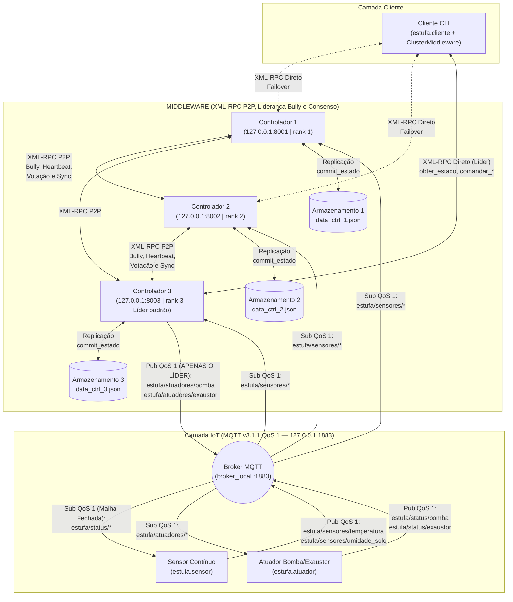

# Trabalho Prático 1 — Controle Automatizado de Estufa Agrícola Distribuída

Sistema distribuído com **comunicação direta Cliente ↔ Controladores via XML-RPC**, **eleição dinâmica de líder (Algoritmo Bully)**, **consenso com persistência replicada síncrona (`data_ctrl_1..3.json`)** e **malha fechada IoT via MQTT v3.1.1 QoS 1**.

---

## 1. Arquitetura do Sistema

O **Middleware** representa a camada lógica distribuída formada pelos 3 Controladores de Processo (`8001..8003`) e pelo módulo `ClusterMiddleware`, responsável pela comunicação RPC com o cliente, coordenação P2P, eleição de líder, votação por quórum e replicação nos arquivos `data_ctrl_1..3.json`.



### Legenda das Camadas, Setas e Comunicações

| Elemento / Seta | Protocolo | Direção e Significado |
|---|---|---|
| **Camada Cliente → Controladores** (`Invocação de Métodos`) | XML-RPC sobre HTTP (`127.0.0.1:8001..8003`) | O `ClusterMiddleware` embarcado no cliente consulta todos os nós ativos (`obter_estado` com consenso), roteia comandos (`comandar_bomba`, `comandar_exaustor`) ao líder atual e faz failover automático se um controlador cair. |
| **Controlador ↔ Controlador** (`Sincronização, Eleição e Tolerância a Falhas`) | XML-RPC P2P (`ping`, `iniciar_eleicao`, `anunciar_lider`, `coletar_voto_estado`, `commit_estado`) | Comunicação direta entre os 3 controladores para monitorar o líder por heartbeat, eleger novo líder (Bully), validar votos antes de gravar e sincronizar réplicas que retornarem após queda. |
| **Controlador ↔ Armazenamento** (`Replicação`) | Disco local JSON (`data_ctrl_1..3.json`) | Após apurar o quórum, o líder envia `commit_estado` síncrono para todas as réplicas ativas gravarem exatamente os mesmos dados oficiais. |
| **Sensor → Broker → Controladores** (`Telemetria`) | MQTT v3.1.1 (`QoS 1`, `:1883`) | `estufa.sensor` publica temperatura e umidade continuamente; os 3 controladores assinam ambos os tópicos e participam da votação iniciada pelo líder. |
| **Líder → Broker → Atuador → Sensor** (`Malha Fechada`) | MQTT v3.1.1 (`QoS 1`, `:1883`) | Somente o Líder publica comandos em `estufa/atuadores/*` após consenso. O Atuador executa e publica confirmação em `estufa/status/*`, invertendo a curva física gerada pelo Sensor. |

---

## 2. Os 7 Processos e Parâmetros de Execução

| Processo | Comando Simplificado | Porta | Papel |
|---|---|---|---|
| **1. Broker MQTT** | `python -m estufa.broker_local` | `127.0.0.1:1883` | Broker MQTT v3.1.1 local (QoS 0 e 1) |
| **2. Controlador 1** | `python -m estufa.controlador 1 [--byzantino]` | `127.0.0.1:8001` | Réplica `ctrl_1` (`rank=1`), banco `data_ctrl_1.json` |
| **3. Controlador 2** | `python -m estufa.controlador 2 [--byzantino]` | `127.0.0.1:8002` | Réplica `ctrl_2` (`rank=2`), banco `data_ctrl_2.json` |
| **4. Controlador 3** | `python -m estufa.controlador 3 [--byzantino]` | `127.0.0.1:8003` | Réplica `ctrl_3` (`rank=3`, líder inicial), banco `data_ctrl_3.json` |
| **5. Atuador** | `python -m estufa.atuador` | — | Executa bomba/exaustor e publica status QoS 1 |
| **6. Sensor Contínuo** | `python -m estufa.sensor [--temp 28] [--umidade 42] [--intervalo 2]` | — | Simulador contínuo em malha fechada |
| **7. Cliente CLI** | `python -m estufa.cliente [--auto] [--intervalo 3]` | — | Interface interativa de monitoramento e controle |

---

## 3. Como Executar

### Preparação do Ambiente Virtual (`.venv`)
```powershell
cd trabalho_pratico1
python -m venv .venv
./.venv/Scripts/python.exe -m pip install -r requirements.txt
```

### Inicialização Interativa em 6 Janelas + Cliente
```powershell
# Limpar processos residuais e arquivos data_ctrl_*.json
powershell -NoProfile -ExecutionPolicy Bypass -File ./scripts/reset_demo.ps1

# Subir Broker, 3 Controladores, Atuador e Sensor em janelas independentes
# (Cada janela já vem com o comando no histórico: Ctrl+C + Seta para Cima para editar e reiniciar!)
powershell -NoProfile -ExecutionPolicy Bypass -File ./scripts/start_all.ps1

# Opcional: iniciar sensor com valores iniciais customizados
powershell -NoProfile -ExecutionPolicy Bypass -File ./scripts/start_all.ps1 -Temp 38 -Umidade 25 -Intervalo 2

# No terminal atual, iniciar o Cliente Direto:
./.venv/Scripts/python.exe -m estufa.cliente
```

> **Execução no Linux:** Utilize `./scripts/start_all.sh [TEMP] [UMIDADE] [INTERVALO]`. Caso tenha Docker ativo, `docker compose up -d` sobe o Mosquitto (`mosquitto/mosquitto.conf`); caso contrário, o script utiliza automaticamente `estufa.broker_local`.

---

## 4. Regras de Controle e Quórum Dinâmico

| Variável | Condição | Ação Oficial (após consenso) |
|---|---|---|
| **Temperatura** | `> 35.0 °C` | Liga Exaustor |
| **Temperatura** | `< 15.0 °C` | Desliga Exaustor |
| **Umidade do Solo** | `< 30.0 %` | Liga Bomba de Irrigação |
| **Umidade do Solo** | `> 70.0 %` | Desliga Bomba de Irrigação |

- **3 controladores ativos:** quórum majoritário ($\ge 2/3$) — mascara até `1` nó `--byzantino` antes de gravar nos bancos JSON.
- **2 controladores ativos:** exige concordância ($2/2$) — qualquer conflito entre os dois (ex: 1 honesto vs 1 bizantino) bloqueia com `ErroQuorum` sem corromper o banco.
- **1 controlador ativo:** modo degradado ($1/1$) — o último nó vivo assume liderança isolada para preservar disponibilidade.
- **Reconexão:** ao religar qualquer controlador derrubado, ele sincroniza o `data_ctrl_X.json` com o líder/cluster antes de reassumir ou participar das votações.

---

## 5. Testes Automatizados e Validação E2E

```powershell
# Suíte completa de testes unitários e de integração (34 testes)
./.venv/Scripts/pytest.exe ./tests -v -p no:cacheprovider

# Validação End-to-End com subprocessos reais (6 etapas: Bully, MQTT, Failover 3->2->1, Sync, Bizantino)
./.venv/Scripts/python.exe ./scripts/validate_e2e.py
```

---

## 6. Documentos de Apoio

- [roteiro_apresentacao.md](./roteiro_apresentacao.md) — Guia enxuto passo a passo para demonstração e injeção de falhas ao vivo.
- [revisao_defesa_tp1.md](./revisao_defesa_tp1.md) — Explicação técnica detalhada linha a linha do código e perguntas de defesa.
- [relatorio/relatorio.md](./relatorio/relatorio.md) — Relatório técnico completo do trabalho.
