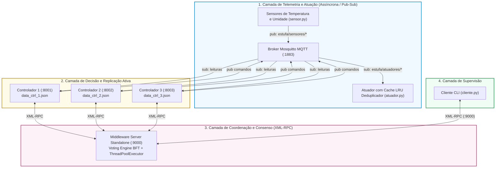

# Guia Definitivo de Revisão e Preparação para a Apresentação — TP1 (Sistemas Distribuídos)
**Projeto:** Estufa Agrícola Automatizada de Alta Disponibilidade (MQTT + XML-RPC)  
**Status do Projeto:** 🟢 **100% CONCLUÍDO** (Sem pendências de código, testes ou documentação)  
**Data da Auditoria:** 02/11/2026  

---

## 1. Diagnóstico de Prontidão: Falta Alguma Coisa?

> [!IMPORTANT]
> **Veredito:** O trabalho está **integralmente implementado, documentado e testado**. Não falta criar nenhuma funcionalidade ou arquivo no código. Você já tem tudo o que o professor pediu no enunciado do PDF e nas orientações em sala.

### Checklist de Requisitos do Enunciado vs. Sua Implementação

| Requisito do Enunciado Oficial | Status | Onde está no seu código |
| :--- | :---: | :--- |
| **Tema Não-Trivial Justificado** | ✅ Concluído | Estufa inteligente: controle microclimático em tempo real de temperatura e umidade ([`relatorio.md`](file:///home/anybody/Documents/Projects/projetos-sistemas-distribuidos/trabalho_pratico1/relatorio/relatorio.md#L11-L24)). |
| **Broker MQTT para Sensores e Atuadores** | ✅ Concluído | Eclipse Mosquitto no Docker ([`docker-compose.yml`](file:///home/anybody/Documents/Projects/projetos-sistemas-distribuidos/trabalho_pratico1/docker-compose.yml) e [`mosquitto.conf`](file:///home/anybody/Documents/Projects/projetos-sistemas-distribuidos/trabalho_pratico1/mosquitto/mosquitto.conf)). |
| **Sensores como Publicadores MQTT** | ✅ Concluído | [`sensor.py`](file:///home/anybody/Documents/Projects/projetos-sistemas-distribuidos/trabalho_pratico1/estufa/sensor.py): simula temperatura (ºC) e umidade (%) com modos `normal`, `quente`, `frio`, `seco`, `umido`. |
| **Atuadores como Assinantes MQTT** | ✅ Concluído | [`atuador.py`](file:///home/anybody/Documents/Projects/projetos-sistemas-distribuidos/trabalho_pratico1/estufa/atuador.py): controla Bomba de Irrigação e Exaustor de Calor com cache LRU anti-duplicação. |
| **Controladores Replicados com Persistência** | ✅ Concluído | 3 réplicas concorrentes ([`controlador.py`](file:///home/anybody/Documents/Projects/projetos-sistemas-distribuidos/trabalho_pratico1/estufa/controlador.py)) gravando estado em JSON independente (`data_ctrl_1.json`, etc.). |
| **Middleware com Comunicação Baseada em Objetos** | ✅ Concluído | [`middleware_server.py`](file:///home/anybody/Documents/Projects/projetos-sistemas-distribuidos/trabalho_pratico1/estufa/middleware_server.py) e [`middleware.py`](file:///home/anybody/Documents/Projects/projetos-sistemas-distribuidos/trabalho_pratico1/estufa/middleware.py): servidor XML-RPC na porta 9000 expondo métodos de objeto. |
| **Tolerância a Falhas de Crash (Fail-Stop)** | ✅ Concluído | Quórum de maioria simples $\lceil(3+1)/2\rceil = 2$. O sistema tolera a morte de 1 controlador sem perder disponibilidade. |
| **Tolerância a Falhas Bizantinas (BFT)** | ✅ Concluído | Motor de votação por maioria no Middleware com normalização de payloads; inclui flag `--byzantino` para forçar réplica mentirosa. |
| **Cliente de Monitoramento e Comando em Tempo Real** | ✅ Concluído | [`cliente.py`](file:///home/anybody/Documents/Projects/projetos-sistemas-distribuidos/trabalho_pratico1/estufa/cliente.py): CLI com menu interativo e modo `--auto` (polling contínuo). |
| **Suíte de Testes Automatizados** | ✅ Concluído | 41 testes com `pytest` cobrindo BFT, quórum, deduplicação LRU, limiares e recuperação. |
| **Relatório Técnico Acadêmico** | ✅ Concluído | [`relatorio.md`](file:///home/anybody/Documents/Projects/projetos-sistemas-distribuidos/trabalho_pratico1/relatorio/relatorio.md) com 303 linhas, equacionamento, tabelas e fundamentação teórica. |

### ⚠️ A Única Pendência Operacional (Configurar antes de apresentar!)

No computador de apresentação, o pacote `paho-mqtt` precisa estar acessível no ambiente Python:

**No Linux:**
```bash
cd /home/anybody/Documents/Projects/projetos-sistemas-distribuidos/trabalho_pratico1
python3 -m venv .venv
source .venv/bin/activate
pip install -r requirements.txt
```

**No Windows (PowerShell):**
```powershell
Set-ExecutionPolicy -Scope Process -ExecutionPolicy Bypass
python -m venv .venv
.\.venv\Scripts\Activate.ps1
pip install -r requirements.txt
```

> [!TIP]
> **Sem Docker no laboratório? Não se preocupe!**
> O Docker serve apenas para subir o Mosquitto na porta 1883. Você pode simplesmente:
> - Instalar o Mosquitto nativo via `winget install EclipseFoundation.Mosquitto` ou instalador .exe de [mosquitto.org](https://mosquitto.org/download/);
> - Ou levar o Mosquitto portátil em um pen drive;
> - Ou instalar um broker MQTT em Python puro via `pip install amqtt` e rodar `amqtt`.
> O resto do sistema (controladores, middleware, sensores, atuadores) roda exatamente igual!

---

## 2. Mapa Mental e Arquitetura do Sistema

O sistema resolve um problema clássico de Sistemas Distribuídos: **como unir mensageria assíncrona orientada a eventos (IoT) com invocação remota síncrona confiável (RPC) sob replicação ativa**.



---

## 3. Os 6 Conceitos de Sistemas Distribuídos que Você Deve Explicar

Quando o professor perguntar: *"Como isso se relaciona com o que estudamos na disciplina?"*, recite estes 6 pontos:

### 1. Comunicação Indireta vs. Comunicação Direta (Híbrida)
*   **Indireta (Assíncrona):** Usamos **MQTT** para os sensores e atuadores. Há **desacoplamento espacial** (os sensores não sabem quais controladores existem) e **desacoplamento temporal** (mensagens transitam pelo broker com QoS 1).
*   **Direta Baseada em Objetos (Síncrona):** Usamos **XML-RPC** sobre HTTP para a interação Cliente $\leftrightarrow$ Middleware $\leftrightarrow$ Controladores. O cliente e o middleware invocam métodos remotos diretamente em instâncias (`SimpleXMLRPCServer.register_instance`), com semântica de pedido-resposta bloqueante.

### 2. Replicação Ativa (Active Replication)
*   Não existe a figura de "controlador primário" ou "líder". Os três controladores (`ctrl_1`, `ctrl_2`, `ctrl_3`) estão ativos em paralelo.
*   Todos recebem a mesma mensagem de telemetria do MQTT, todos rodam a mesma máquina de estados e todos decidem de forma autônoma.
*   **Vantagem teórica:** Recuperação imediata sem tempo de eleição de líder. Se uma réplica cai, as outras duas continuam respondendo sem pausa.

### 3. Deduplicação e Semântica *Effectively-Once* (O Cache LRU)
*   **O Problema Teórico:** Na replicação ativa, se os 3 controladores decidem ligar a bomba d'água ao mesmo tempo, 3 mensagens MQTT de acionamento serão publicadas. Sem proteção, a estufa receberia 3 comandos físicos de irrigação.
*   **A Solução Implementada:**
    *   **Para comandos automáticos (sensores):** O controlador gera um ID determinístico via hash MD5:
        $$\text{comando\_id} = \text{MD5}(\text{acao} + \text{sensor\_timestamp})$$
        Como o `sensor_timestamp` veio no payload original do sensor e é exatamente idêntico nas 3 réplicas, todos os 3 controladores geram o **mesmo hash**.
    *   **Para comandos manuais do cliente:** O Middleware gera um único `UUID` antes de fazer broadcast para as réplicas.
    *   **No Atuador ([`atuador.py`](file:///home/anybody/Documents/Projects/projetos-sistemas-distribuidos/trabalho_pratico1/estufa/atuador.py#L40-L75)):** Existe um cache **LRU (Least Recently Used)** implementado com `collections.OrderedDict` com capacidade de 50 entradas. O atuador executa a primeira mensagem que chega e descarta as próximas 2 imediatamente como duplicatas.

### 4. Tolerância a Falhas de Crash via Quórum de Maioria
*   Usamos a regra de maioria estrita: com $n = 3$ nós, o quórum mínimo é:
    $$Q = \left\lceil \frac{n + 1}{2} \right\rceil = \left\lceil \frac{4}{2} \right\rceil = 2$$
*   Se um controlador sofrer um *crash* (processo finalizado ou cabo puxado), o Middleware detecta o timeout/recusa de conexão via `concurrent.futures.ThreadPoolExecutor`, mas como obteve 2 respostas idênticas dos nós sobreviventes, atinge o quórum e devolve sucesso transparente ao cliente.

### 5. Tolerância a Falhas Bizantinas (BFT - Byzantine Fault Tolerance)
*   **O Que É:** Uma falha bizantina ocorre quando um nó não apenas para de responder, mas responde **dados falsos ou corrompidos** (ex.: invasão hacker, falha de memória RAM, bug de software).
*   **Como Resolvemos ([`middleware.py`](file:///home/anybody/Documents/Projects/projetos-sistemas-distribuidos/trabalho_pratico1/estufa/middleware.py#L70-L130)):**
    *   O Middleware faz requisições em paralelo para os 3 nós.
    *   Ele **normaliza os dados** (remove o campo volátil `timestamp`, pois pequenas variações de milissegundos poderiam quebrar a comparação).
    *   Executa uma votação por contagem de frequências (`collections.Counter`).
    *   Se $ctrl_2$ mentir que a temperatura é $999.0^\circ\text{C}$, mas $ctrl_1$ e $ctrl_3$ informarem $24.5^\circ\text{C}$, a resposta honesta atinge 2 votos contra 1 voto mentiroso. A resposta maliciosa é descartada e o cliente recebe o dado correto.

### 6. Transferência de Estado (State Transfer)
*   Quando uma réplica renasce após um crash (ou sobe atrasada no boot), seu JSON local pode estar desatualizado.
*   Antes de começar a escutar o MQTT, o controlador executa `_sincronizar_estado_via_middleware()` ([`controlador.py`](file:///home/anybody/Documents/Projects/projetos-sistemas-distribuidos/trabalho_pratico1/estufa/controlador.py#L115-L140)), consultando o Middleware.
*   O Middleware faz uma votação entre as réplicas ativas e devolve o estado auditado por quórum. A réplica atualiza seu estado e só então começa a consumir o broker.

---

## 4. As 5 "Perguntas de Pegadinha" do Professor (e Como Responder)

### Pergunta 1: *"O seu sistema não tem nenhum ponto único de falha (SPOF)?"*
*   ❌ **Resposta Errada:** "Não tem, porque eu repliquei o controlador em 3 instâncias." *(O professor vai te dar zero aqui).*
*   ✅ **Resposta Correta:**
    > *"Os controladores possuem alta disponibilidade e tolerância a falhas. Porém, nesta implementação acadêmica, o **Broker Mosquitto** e o **Middleware Server (:9000)** são pontos únicos de falha estruturais. Em um ambiente industrial real, o Mosquitto operaria em cluster de alta disponibilidade (como EMQX ou RabbitMQ) e o Middleware seria replicado usando um protocolo de eleição de líder como Raft ou Paxos."*

### Pergunta 2: *"A teoria clássica de Lamport diz que para tolerar $m$ falhas bizantinas são necessários no mínimo $3m + 1$ nós. Por que você usou apenas 3 nós para 1 falha bizantina?"*
*   ❌ **Resposta Errada:** "Porque 3 nós já dá maioria de 2 contra 1."
*   ✅ **Resposta Correta:**
    > *"O teorema $n \ge 3m + 1$ de Pease, Shostak e Lamport aplica-se ao consenso ponto-a-ponto entre nós arbitrários onde qualquer nó pode retransmitir mentiras diferentes para nós diferentes (problema dos Generais Bizantinos completo). Na nossa arquitetura, nós temos um **Coordenador/Juiz Confiável (o Middleware)** atuando sobre réplicas passivas através de Redundância Modular Tripla (TMR). Como o Middleware recebe diretamente as 3 respostas e avalia por maioria estrita, se no máximo 1 réplica mentir, sobram 2 réplicas honestas que geram respostas idênticas. Como $2 > 1$, a maioria honesta vence sem necessidade do 4º nó."*

### Pergunta 3: *"Por que vejo logs de 'Tentativa 1/10 — Middleware indisponível' quando ligo o primeiro controlador?"*
*   ❌ **Resposta Errada:** "É um bugzinho de sincronização na inicialização."
*   ✅ **Resposta Correta:**
    > *"Não é bug, é a prova prática da segurança do quórum! O controlador 1, ao subir, tenta fazer State Transfer com o Middleware. Mas como os controladores 2 e 3 ainda não subiram, o Middleware não atinge o quórum mínimo de 2 respostas e recusa a consulta. O controlador 1 aguarda nas tentativas configuradas; assim que o controlador 2 sobe, o quórum é satisfeito e a sincronização conclui com sucesso."*

### Pergunta 4: *"Como você garante que 3 controladores não façam o atuador executar 3 vezes o mesmo comando?"*
*   ✅ **Resposta Correta:**
    > *"Através de duas técnicas complementares: idempotência via ID determinístico e cache LRU no atuador. Em comandos automáticos disparados por sensores, cada controlador gera um hash MD5 baseado na ação e no timestamp original da leitura do sensor. Como o timestamp é comum a todos, os 3 controladores geram o mesmo hash. O atuador mantém uma fila LRU de 50 posições; ao receber a primeira mensagem, ele aciona o relé simulado e descarta as outras 2 mensagens com o mesmo hash como duplicatas."*

### Pergunta 5: *"Por que XML-RPC é considerado comunicação baseada em objetos se o Python tem Pyro4 ou Java tem RMI?"*
*   ✅ **Resposta Correta:**
    > *"Conforme a bibliografia clássica de Tanenbaum e Coulouris, RPC e RMI compartilham o princípio fundamental da transparência de invocação de procedimentos e métodos remotos. No projeto, utilizamos XML-RPC da biblioteca padrão com `server.register_instance(self)`, expondo instâncias de classes e permitindo a invocação remota de métodos de objetos de serviço através de HTTP, sem dependências proprietárias pesadas."*

---

## 5. Roteiro Prático de Demonstração em Sala (10 a 15 Minutos)

Abra os **8 terminais** (use abas do terminal ou tmux) e siga esta ordem estrita:

```
┌─────────────────────────┬────────────────────────┐
│ Terminal 1: Broker MQTT │ Terminal 2: Middleware │
├─────────────────────────┼────────────────────────┤
│ Terminal 3: Ctrl 1      │ Terminal 4: Ctrl 2     │
├─────────────────────────┼────────────────────────┤
│ Terminal 5: Ctrl 3      │ Terminal 6: Atuador    │
├─────────────────────────┼────────────────────────┤
│ Terminal 7: Sensor      │ Terminal 8: Cliente    │
└─────────────────────────┴────────────────────────┘
```

### Inicialização (Passo a Passo)

1. **Terminal 1 (Broker MQTT):**
   ```bash
   docker compose up -d
   ```
2. **Terminal 2 (Middleware Server):**
   ```bash
   python -m estufa.middleware_server
   ```
3. **Terminais 3, 4 e 5 (Controladores):**
   ```bash
   # Terminal 3:
   python -m estufa.controlador --id ctrl_1 --port 8001 --data data_ctrl_1.json
   # Terminal 4:
   python -m estufa.controlador --id ctrl_2 --port 8002 --data data_ctrl_2.json
   # Terminal 5:
   python -m estufa.controlador --id ctrl_3 --port 8003 --data data_ctrl_3.json
   ```
4. **Terminal 6 (Atuador):**
   ```bash
   python -m estufa.atuador
   ```
5. **Terminal 7 (Sensor):**
   ```bash
   python -m estufa.sensor --modo normal
   ```
6. **Terminal 8 (Cliente):**
   ```bash
   python -m estufa.cliente
   ```

---

### Os 3 Experimentos ao Vivo para Mostrar ao Professor

#### Experimento 1: Deduplicação LRU sob Replicação Ativa
1. No **Terminal 7 (Sensor)**, dê `Ctrl+C` e rode em modo seco:
   ```bash
   python -m estufa.sensor --modo seco
   ```
2. Mostre para o professor:
   - Nos **Terminais 3, 4 e 5**, os 3 controladores detectam umidade baixa e publicam `LIGAR bomba`.
   - No **Terminal 6 (Atuador)**, apenas a primeira mensagem ativa a bomba (`💧 Bomba → LIGADA`), enquanto as outras duas exibem: `🔁 Comando duplicado ignorado`.

#### Experimento 2: Tolerância a Crash e State Transfer
1. No **Terminal 5 (`ctrl_3`)**, pressione `Ctrl+C` (derrubando o processo).
2. No **Terminal 8 (Cliente)**, consulte o estado ou envie um comando manual.
3. Aponte no **Terminal 2 (Middleware)** o log indicando que `ctrl_3` caiu, mas que o quórum de 2 respostas manteve o sistema funcionando perfeitamente.
4. Reinicie o `ctrl_3` no **Terminal 5**:
   ```bash
   python -m estufa.controlador --id ctrl_3 --port 8003 --data data_ctrl_3.json
   ```
5. Aponte no log do `ctrl_3`: `🔄 Iniciando sincronização de estado via Middleware... ✅ Estado sincronizado com sucesso` (**State Transfer** comprovado).

#### Experimento 3: Ataque/Falha Bizantina Neutralizada
1. No **Terminal 4 (`ctrl_2`)**, dê `Ctrl+C`.
2. Reinicie o `ctrl_2` com a flag de corrupção bizantina:
   ```bash
   python -m estufa.controlador --id ctrl_2 --port 8002 --data data_ctrl_2.json --byzantino
   ```
3. No **Terminal 8 (Cliente)**, consulte o estado.
4. Mostre na tela:
   - O `ctrl_2` está mentindo que a temperatura é `999.0°C`.
   - O Middleware no **Terminal 2** computa: 2 votos para a resposta honesta e 1 voto para a bizantina.
   - O Cliente recebe o valor real e honesto, provando que a falha bizantina foi filtrada com sucesso.

---

## 6. Como Rodar os Testes Automatizados (Caso o Professor Peça)

Para executar a bateria de testes que valida toda essa arquitetura matematicamente:

```bash
# Rodar todos os testes do Middleware (BFT, Quorum, Crash)
pytest tests/test_middleware.py -v

# Rodar todos os 41 testes (requer o ambiente virtual ativo)
pytest tests/ -v
```
